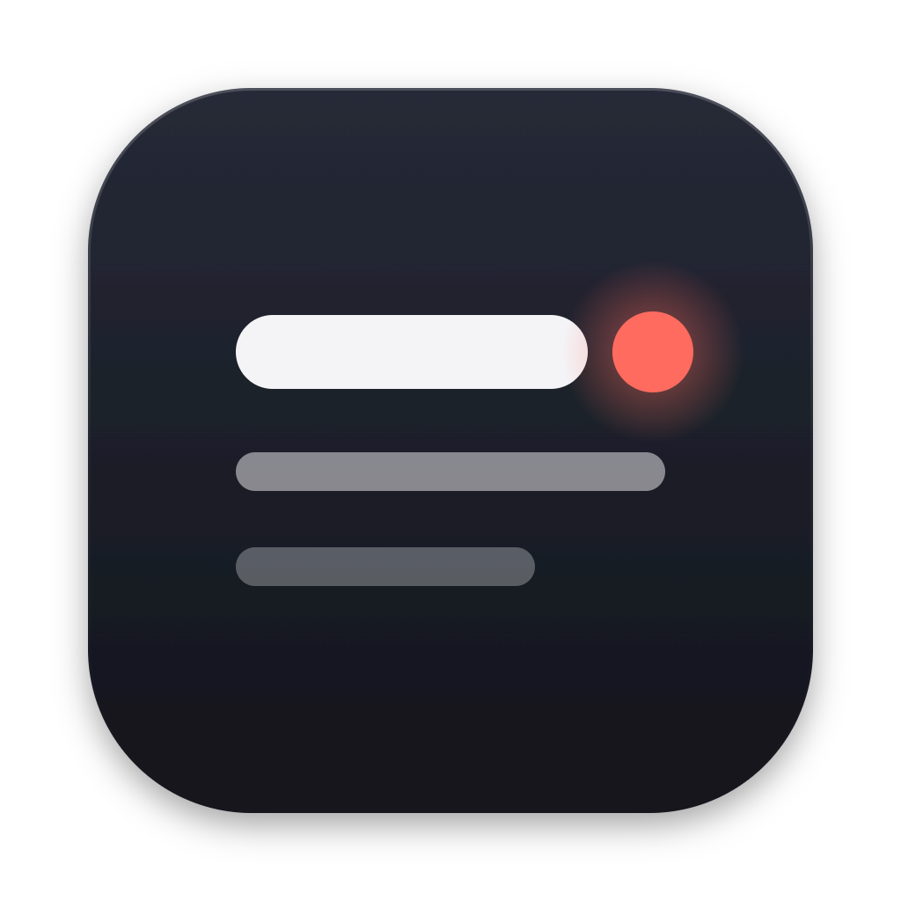

<p align="center"></p>

<h1 align="center">News Monitor</h1>

<p align="center">A macOS menu bar app that watches the front pages of the papers you subscribe to and tells you when something big happens.</p>

---

News Monitor keeps the WSJ, the New York Times, the Financial Times, Bloomberg, Reuters, or any other news site you add open in a browser that has your logins. A few times an hour it reads each front page the way you would: what's the lead, what's in big type, what's marked Live, and what every outlet is running at once. When a story clears the bar you get a native notification. Everything else goes into a daily briefing.

It runs entirely on your Mac. There are no servers, accounts, AI APIs or telemetry.

## Features

- **Breaking-news alerts** come from front-page placement, cross-outlet coverage, Live and Breaking labels, and a keyword list you control. Every alert records exactly why it fired.
- **Morning briefing** shows what happened since last evening in four sections: *Top stories*, *Macro* (economy, markets, world, policy), *Micro* (companies, tech, industries) and *Under the radar*. You choose how many go in each.
- **What's new** shows the most important stories since you last looked, one entry per story.
- **Alert inbox** has a badge for anything you missed. The menu bar panel shows what's flagged right now.
- **Your logins.** Each source has its own persistent browser session, so checks see what a subscriber sees. You get a notification if a session expires.
- **Built-in ad and tracker blocking**, using EasyList/EasyPrivacy-based lists.
- **Reading themes.** Optional [Catppuccin](https://github.com/catppuccin/catppuccin) palettes (Latte, Frappé, Macchiato, Mocha, with 14 accents) can be applied to news pages and to the app. Pages are themed before they paint, including cookie banners, paywall dialogs and embedded charts.
- **Learns what you read, gently.** Opens and 👍/👎 nudge your briefings. The effect is bounded, every boost is shown with its reason, and you can reset it.
- **Custom sources.** Add any news site from Settings with a name and a URL.

## Download

Get the latest DMG from [**Releases**](https://github.com/Jprdgza/news-monitor/releases/latest): `arm64` for Apple-silicon Macs (M1 and later), `x64` for Intel. Open it and drag **News Monitor** into **Applications**.

The app isn't notarized by Apple (that needs a paid developer account), so macOS blocks the first launch:

1. Open News Monitor. When macOS says it can't verify the app, click **Done**.
2. Go to **System Settings → Privacy & Security**, scroll down to *"News Monitor" was blocked*, and click **Open Anyway**.

You only do this once per download. Or, in Terminal: `xattr -dr com.apple.quarantine "/Applications/News Monitor.app"`.

Requires macOS 12 or later.

**Updating:** quit News Monitor from its menu bar icon, open the new DMG, drag the app into **Applications** and choose **Replace**. Your sources, settings and sign-ins are kept, because they live in your user folder, not inside the app. A new download needs **Open Anyway** once more.

## Build from source

Requires macOS and Node.js 22 or newer.

```bash
git clone https://github.com/Jprdgza/news-monitor.git
cd news-monitor
npm run setup        # installs dependencies and downloads Electron
npm run pack         # builds release/mac-arm64/News Monitor.app
npm run dist         # builds the DMGs and zips for both architectures
```

Copy `News Monitor.app` to `/Applications` and open it. The build is ad-hoc signed, so the first launch may need right-click → **Open**. Run from `/Applications`, it registers itself to start at login.

**Optional, recommended:** create a self-signed code-signing certificate named *News Monitor Local Signing* (Keychain Access → Certificate Assistant → Create a Certificate…, type *Code Signing*). `npm run pack` signs with it when it exists. macOS then recognizes each new build as the same app and keeps its Keychain access, instead of asking again after every update.

To run from source without packaging, use `npm start`.

### First run

1. Sign in to each paywalled source in its tab. The dot on a tab means you aren't signed in yet.
2. Right-click the menu bar icon and choose **Send test notification**. Allow notifications when macOS asks, then set the style to *Persistent* in System Settings → Notifications → News Monitor if you don't want big stories to slip away.
3. Pick your sources in **Settings → Sources**.

## How it works

### Checks

Each check opens every enabled front page in a hidden window that shares that source's signed-in session. The window waits for the page to render and records each headline: its text, its summary, its order on the page and the size of its type. Then the window is destroyed. These windows don't load images, video or web fonts, and they run with ads and trackers blocked. If a page can't be read, the source's public RSS feed is used instead and the status bar says so.

Checks run every 10 minutes (±2) from 6am to 11pm in your configured time zone, and every 30 minutes (±5) overnight. On battery the interval stretches 1.5×. While the screen is locked the app uses the overnight pace, then checks as soon as you unlock. It also checks right after waking from sleep.

### What makes a story "big"

| Signal | Points |
| --- | --- |
| Lead story on its front page | +4 |
| One of the top three stories (early on the page *and* in large type) | +2.5 |
| Covered by other outlets | +2.5 for the first, +1.5 for each additional, up to +6 |
| Top story on more than one front page | +2 |
| "Breaking" label | +3 |
| Live coverage that started in the last 6 hours | +2.5 |
| Just landed near the top (first seen in the last 45 minutes) | +1 |
| Held a top slot for 3+ checks | +1 |
| Keyword categories (Fed, ceasefire, bankruptcy, …) | +1 each, up to +2 |
| Routine live blogs ("Live Markets", "Stock market today") | −2.5 |
| Short sub-links and explainer-style questions | −2 / −1.5 |
| Opinion and commentary | ×0.4, never alerts |

A story alerts at **6 points**, or 9 overnight. Several guards keep alerts rare:

- The same story on another outlet never alerts twice.
- A new angle on a story you were already alerted to needs 2.5 extra points.
- After six alerts in a day, only very large stories get through.
- At most three notifications are sent per check.

Every threshold and weight lives in `config.json`.

**Matching stories across outlets.** Headlines are reduced to word stems and compared with an IDF-weighted cosine similarity. A shared rare word ("Bahrain", "measles") counts for much more than a shared common one ("Trump", "says"). The thresholds were tuned on several days of real front pages so that "SpaceX Catches Starship" matches "SpaceX Makes History With Rocket Catch", while two unrelated Nvidia stories don't merge.

### The briefing

The same story on several front pages becomes one entry, labeled "Also in FT, RTRS". Entries are ranked by peak score plus how many outlets ran the story. Each section is then filled with [Maximal Marginal Relevance](https://www.cs.cmu.edu/~jgc/publication/The_Use_MMR_Diversity_Based_LTMIR_1998.pdf), which picks each next story by importance minus its similarity to stories already picked. That keeps a briefing from being five angles on the same event. The *Variety* slider in Settings controls that trade-off.

Topics come from the article's URL section (`/economy/`, `/business/`, `/tech/`), which is reliable, with a keyword lexicon as a fallback. *Under the radar* shows stories that only one outlet ran and that never scored high, but that held a front-page spot for hours.

### Personalization

Each story has a few features: its topic, its source, and some distinctive headline words. Opening a story counts for those features, 👍 counts three times as much, and 👎 counts against them. Stories you scroll past in a briefing count slightly against. Evidence fades with a 30-day half-life. Affinity is shrunk toward zero until there's enough evidence, so a single click barely registers. The final boost is capped at ±1.5 points, and the "Why?" panel shows its reason ("you often read Markets stories").

By default this only reorders briefings. You can let it nudge alerts too, by at most ±0.75 points. The model is a small JSON file in the app's data folder. **Settings → Personalization → Reset** clears it.

### Reading themes

News pages are recolored by [Dark Reader](https://github.com/darkreader/darkreader)'s dynamic engine, loaded as a preload script. It starts in every frame of a tab before the first paint, so there's no white flash and iframes are themed too. Stylesheets served from other domains, which the page itself isn't allowed to read, are fetched by the main process. Only public `http(s)` URLs returning CSS or images are allowed. Hidden check windows are never themed.

Two adjustments make news sites look right:

- **Paper tints become the theme background.** Light backgrounds with very little color, such as the FT's salmon paper or cream panels, are treated as neutral. Otherwise Dark Reader keeps their hue and they turn brown.
- **Per-site fixes.** These come from Dark Reader's community list (`assets/theme-fixes.json`, refreshed with `node scripts/update-theme-fixes.js`), plus a few of our own in `theme.ts`, such as the FT and Barron's mastheads.

## Battery and memory

Two things dominate the app's energy use: the pages it keeps open, and the checks themselves. Both were measured on an Apple-silicon MacBook with five sources enabled.

| | Before | After |
| --- | --- | --- |
| Idle with the window closed (5 tabs) | 290–520 MB, 11 processes, 0.1–0.5% CPU | 150–260 MB, 5 processes, ~0% CPU |
| One check of all five front pages | ~28 s of CPU time, ~27 s wall, ~690 MB peak | ~17 s of CPU time, ~23 s wall, ~530 MB peak |

*Before* means tabs stay loaded, with no ad blocking and images loaded during checks. *After* means tabs are unloaded, ads and trackers are blocked, and checks skip images, video and fonts. The figures are averages of repeated runs and include Electron's startup. Hidden tabs were already throttled by Chromium, so unloading them mostly saves memory and background wake-ups rather than raw CPU.

Pages you're reading stay loaded while the window is open. Tabs you haven't looked at for 5 minutes, and every tab once the window has been closed for 2 minutes, are unloaded. Reopening a tab takes about a second and returns to the article you were on.

## Sources

Built in: WSJ, NYT, Financial Times, Bloomberg and Reuters (on by default), plus The Economist, Barron's, CNBC, AP, Axios, MarketWatch and Politico.

To add any other site, use **Settings → Sources** with a name, the front-page URL, and an optional RSS feed. Custom sources use a generic rule for recognizing article links. To tune it, edit `articlePattern` for that source in `config.json`.

If a site redesigns and stops being read:

```bash
npm run check-sources
```

This reads every built-in front page once and prints how many headlines it found, the top few, and the sign-in state. Each built-in source is a small entry in [`src/main/sources/presets.ts`](src/main/sources/presets.ts). Usually only its `articlePattern` regex needs updating.

## Configuration

Most settings are in the app (⌘,). Everything else is in `config.json` in the data folder (tray menu → **Open config file**), which is reloaded as soon as you save it. Invalid values fall back to defaults.

Data lives in `~/Library/Application Support/News Monitor/`:

| File | Contents |
| --- | --- |
| `config.json` | Your settings |
| `data/stories.json` | Headlines, summaries and scores (45 days) |
| `data/alerts.jsonl` | One line per alert, with the signals that fired it |
| `data/prefs.json` | The personalization model |
| `logs/news-monitor.log` | Activity log (rotated at 5 MB) |

## Privacy

- Your browsing sessions, history and reading habits stay on your Mac.
- The app contacts only the news sites you enable, their public RSS feeds, and Ghostery's CDN, from which it downloads the blocklists once a week.
- It reads front pages at roughly the pace a person would. It never crawls, bulk-downloads articles, or republishes anything.

## Development

```bash
npm start              # build and run
npm test               # unit tests (scoring, matching, ranking, config validation, …)
npm run dry-run        # one check against live pages, prints every score, no notifications
npm run check-sources  # sanity-check every built-in front page
npm run icons          # re-render the icons from assets/*.svg
```

`--dry-run` and `--once` refuse to start while the app is already running, because both would use the same data folder. Quit it from the menu bar first. In development builds, `NEWS_MONITOR_USER_DATA=/tmp/copy` points everything at a copy of the data folder.

```
src/main/
  main.ts          window, tabs, menu bar panel, IPC
  watcher.ts       the check loop and alert decisions
  scoring.ts       scoring rules            match.ts    text similarity
  rank.ts          events + MMR             topics.ts   macro / micro tagging
  digest.ts        briefing queries         prefs*.ts   personalization
  sessions.ts      per-source sessions, ad blocking, permissions
  theme.ts         Catppuccin palettes, Dark Reader injection
  sources/         built-in sources and the in-page extractor
src/renderer/      the interface (plain TypeScript, no framework)
```

### Security model

- The app's own windows are sandboxed, use context isolation and a strict Content Security Policy, and can't navigate.
- The interface reaches the main process through a short list of IPC calls. Each call checks its sender and validates its arguments.
- News pages run sandboxed. The only preloads in their frames are the ad blocker's and the theme's, both in an isolated world. Permission requests (camera, location, notifications, …) are denied.
- The extractor runs in an isolated JavaScript world, so a page can't tamper with it.
- Links only open in your browser if they are `http(s)`.
- **Your sign-ins are encrypted at rest.** Cookies are encrypted with a key kept in the macOS Keychain, so another program can't lift your sessions by copying the app's files. Cookies saved by older versions are re-encrypted once, and the plain-text copies are then removed from disk.
- **No debugging backdoor.** The packaged app refuses to start with `--remote-debugging-port` or `--inspect`, and the `RunAsNode`, `NODE_OPTIONS` and inspector fuses are off. The app's code is integrity-checked at launch (asar integrity fuse).
- **Phishing-resistant sign-in.** Publisher sign-in happens inside the source's tab, whose real host is always shown in the toolbar (with "Not secure" on plain HTTP). Popups open only for Google, Apple, Facebook and Microsoft sign-in, and their title bar always shows the real host. Blank windows, which a page could fill with a fake form, never open.
- New sign-ins are written to disk within seconds and again before quitting, so a crash doesn't sign you out.
- Cookies are never logged, sent anywhere, or read by the app outside Chromium's own cookie store.

## License

[MIT](LICENSE). Ad blocking uses [@ghostery/adblocker](https://github.com/ghostery/adblocker) (MPL-2.0), and themes use [Dark Reader](https://github.com/darkreader/darkreader) (MIT) and the [Catppuccin palette](https://github.com/catppuccin/palette) (MIT).

This project isn't affiliated with any of the publications it reads. You need your own subscriptions.
